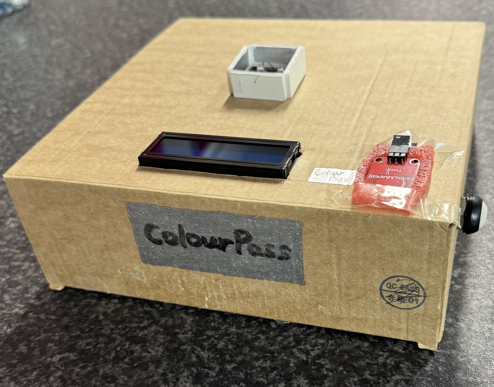
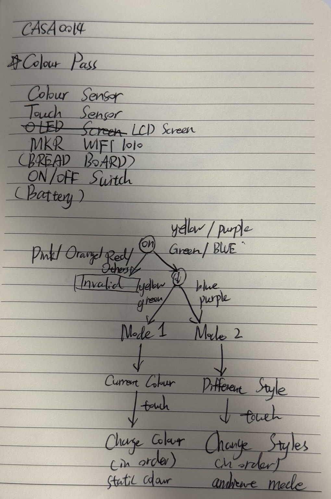
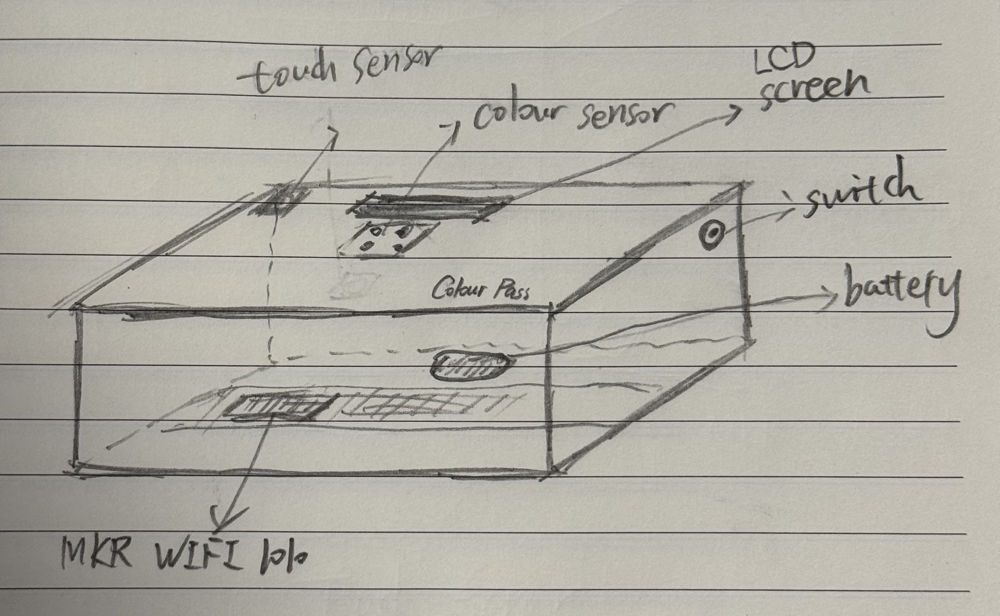
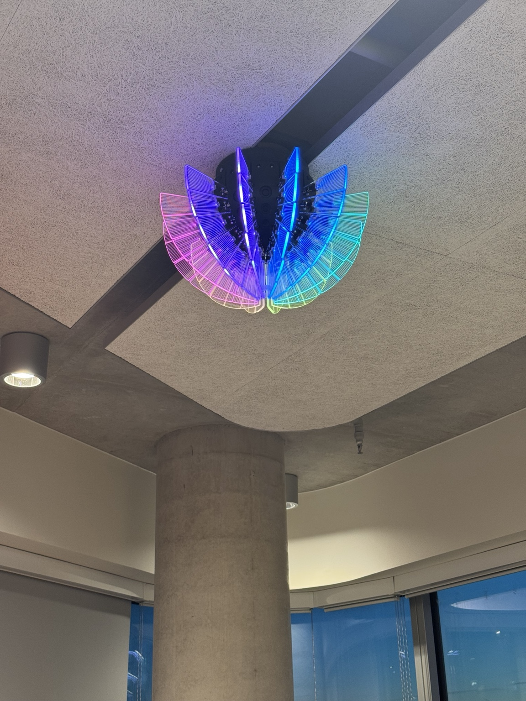
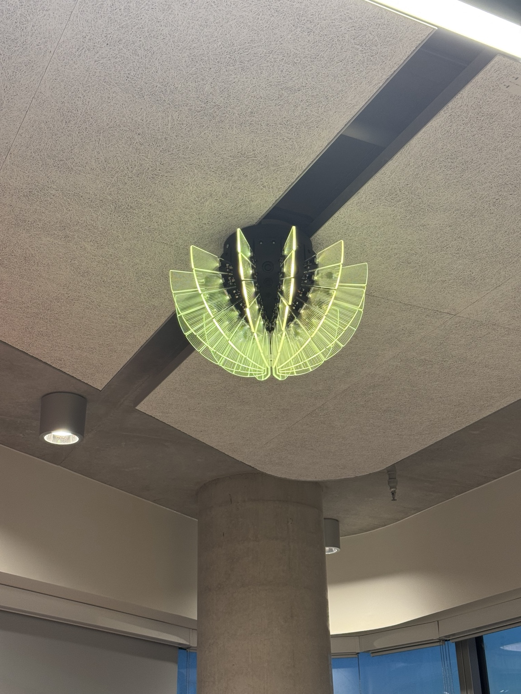

 

  

# ColourPass–Vespera
## An Interactive Colour-Based Ticket Validation and Lighting Control System

## 1. Project Overview

**ColourPass–Vespera** is an interactive Internet of Things (IoT) prototype that transforms colour recognition into a physical interface for controlling the Vespera lighting installation at UCL East.

Inspired by ticket validation systems used in public transport and football event venues, the project explores how simple physical interactions can be translated into different lighting experiences within a connected environment.

Users present a coloured card to the device. An Arduino MKR WiFi 1010 processes the colour sensor readings, determines the validation outcome and communicates lighting instructions to Vespera through Wi-Fi and MQTT. A touch sensor allows users to switch between lighting effects, while an LCD screen provides immediate feedback.

The prototype combines **physical interaction, sensor-based decision-making, embedded programming and networked lighting control**.

<!-- Physical Prototype -->

  

## 2. Initial Concept and Design

The project began with hand-drawn sketches exploring the system's intended functionality and physical arrangement.

The initial concept divided coloured tickets into three categories: rejected tickets, tickets activating static lighting and tickets activating ambient lighting. Touch interaction was introduced to allow users to change lighting effects without repeatedly scanning cards.

The physical design proposed a compact enclosure containing the colour sensor, LCD screen, touch sensor, Arduino board, power switch and internal wiring.

### Initial System Logic

<!-- Initial System Logic -->

  

### Initial Physical Prototype Design

<!-- Initial Physical Prototype -->

  

These sketches provided a starting point for development. The design was subsequently modified in response to hardware integration, colour-recognition testing and practical prototyping constraints.

## 3. How ColourPass Works

The interaction follows a sequence:

**Colour Detection → Ticket Validation → Lighting Feedback → Mode Selection → Touch Interaction**

### Ticket Validation

| Ticket Colour | Validation | System Response |
|---|---|---|
| Red | Denied | Red flashing light |
| Orange | Denied | Red flashing light |
| Pink | Denied | Red flashing light |
| Yellow | Granted | Static Mode – Yellow |
| Green | Granted | Static Mode – Green |
| Blue | Granted | Ambient Mode – Blue Mood |
| Purple | Granted | Ambient Mode – Rainbow |
| White | Not authorised | No new lighting action |
| Black | Not authorised | No new lighting action |
| Unknown | Not authorised | No new lighting action |

When access is granted, a two-second animated green-and-white confirmation is displayed before entering the appropriate lighting mode.

Rejected tickets produce a red flashing response before the system returns to white standby lighting.

ColourPass also supports continuous ticket recognition, allowing different tickets to be presented without restarting the controller.

### Static Lighting Mode

Yellow and green tickets activate Static Mode.

The initial lighting colour matches the validated ticket. Each short touch advances through six solid colours:

**Yellow → Green → Cyan → Blue → Purple → Pink → Repeat**

### Ambient Lighting Mode

Blue and purple tickets activate Ambient Mode.

6 distinct lighting themes are implemented:

| Theme | Lighting Effect |
|---|---|
| Blue Mood | Animated blue-purple gradient |
| Rainbow | Multicolour rainbow pattern |
| Forest | Animated green-toned lighting |
| Sunset | Animated warm-colour gradient |
| Disco | Dynamic multicolour lighting |
| Bayern | Alternating red and white lighting |

Blue tickets initially activate Blue Mood, while purple tickets activate Rainbow.

The touch sequence contains seven positions, with Blue Mood appearing twice, providing different starting points for the two ticket colours.

### Touch Interaction

| Interaction | Function |
|---|---|
| Single Tap | Change the current colour or lighting theme |
| Hold for 3 seconds | Display a background-recheck prompt |
| Release after 3–5 seconds | Recheck the empty scanning background |
| Hold for 5 seconds | Display a full-reset prompt |
| Release after 5 seconds | Restart the controller and reload colour profiles |

The LCD displays the long-press prompts as their respective thresholds are reached, helping users distinguish between the two reset operations.

## 4. Hardware and System Architecture

The prototype integrates the following components:

| Component | Purpose |
|---|---|
| Arduino MKR WiFi 1010 | Main controller and Wi-Fi connectivity |
| DFRobot Colour Sensor | Colour recognition |
| Capacitive Touch Sensor | User interaction and reset |
| LCD1602 RGB Screen | System status and feedback |
| Adafruit NeoPixel Strip | Local lighting preview |
| ON/OFF Switch | Physical power control |
| Battery | Portable power supply |
| Cardboard Enclosure | Physical structure and component positioning |

The main communication workflow is:

**Colour Sensor → Arduino Processing → Lighting Engine → MQTT Broker → Vespera**

The Lighting Engine generates RGB data for a 12 × 6 LED matrix, producing 216 RGB bytes per complete frame.

The software is organised into separate modules responsible for colour sensing, touch input, LCD feedback, lighting generation and MQTT communication.

This modular approach supports debugging and refinement without requiring the entire program to be rewritten.

## 5. Development Process

ColourPass was developed through five documented stages, progressing from individual component experiments to a physically assembled and network-connected prototype.

| Stage | Development Focus | Documentation |
|---|---|---|
| Part 01 | Initial colour sensor measurements and testing | [Colour Sensor Testing](design-log/part-01-colour-sensing/README.md) |
| Part 02 | Hardware integration, LCD feedback and preliminary colour calibration | [Hardware Integration and Colour Calibration](design-log/part-02-hardware-integration-and-colour-calibration/README.md) |
| Part 03 | Modular software development, MQTT communication and lighting effects | [MQTT Integration and Lighting Control](design-log/part-03-mqtt-integration-and-lighting-control/README.md) |
| Part 04 | Cardboard enclosure construction and sensor positioning improvements | [Physical Prototype Construction](design-log/part-04-physical-prototype-construction/README.md) |
| Part 05 | On-site colour measurements, code refinement and physical Vespera testing | [Colour Recognition and Code Refinement](design-log/part-05-colour-recognition-and-code-refinement/README.md) |

Each development log records the objectives, implementation, testing evidence, observations and limitations of that stage.

## 6. Key Design Iterations

Throughout development, ColourPass underwent several design iterations in response to practical challenges and testing observations. Three significant improvements demonstrate how the project evolved from its initial concept into a more complete interactive IoT prototype.

### Iteration 1 — Adding an LCD Screen

The original concept consisted of a colour sensor, touch sensor and Arduino controller, without a dedicated display.

As development progressed, I realised that lighting feedback alone might not clearly communicate the system's current state, particularly during ticket validation, colour calibration and network connection.

I therefore introduced an LCD1602 RGB screen to provide real-time information, including ticket validation results, lighting modes, Wi-Fi/MQTT connection status and reset instructions.

This modification improved the clarity of user interaction and reduced reliance on the Arduino Serial Monitor.

### Iteration 2 — Improving Wi-Fi and MQTT Connectivity

During initial MQTT integration, I encountered connectivity problems when attempting to communicate with Vespera through the student accommodation Wi-Fi network. Testing with a mobile hotspot successfully established communication with the MQTT broker.

This experience highlighted the importance of network compatibility and connection reliability in IoT systems.

The software was subsequently refined to include automatic Wi-Fi and MQTT reconnection attempts, connection-failure notifications on the LCD screen, and a startup mechanism that waits for network connectivity before enabling normal ticket interaction.

These improvements made network behaviour more transparent and helped the prototype recover from temporary communication failures. However, long-term connection reliability still requires further evaluation.

### Iteration 3 — Improving the Colour Sensor's Physical Environment

After assembling the components inside the cardboard enclosure, I observed that colour recognition was sometimes less consistent than during earlier hardware testing.

Surrounding light and variations in card positioning appeared to affect the sensor readings.

To address this, I added a small raised cardboard frame around the colour sensor. This modification was intended to reduce interference from surrounding light and provide a more consistent scanning position for coloured tickets. The retesting suggested improved recognition stability/

## 7. Colour Calibration and Testing

Colour recognition was further refined through on-site testing in the **Connected Environments Lab at One Pool Street, UCL East**.

Raw sensor readings were collected for nine coloured cards. The measured R, G, B and clear-channel pulse values were recorded and incorporated into the program as predefined reference profiles.

The latest implementation uses:

- Preset colour-reference profiles.
- Median filtering to reduce isolated reading fluctuations.
- Normalised colour features and distance-based classification.
- Background measurement to help distinguish cards from an empty scanning area.
- Consecutive matching readings to reduce accidental detections.

Unlike earlier versions, the latest program does not require all nine colour cards to be recalibrated during every startup. Instead, it loads the stored profiles and measures the current empty background before enabling normal ticket scanning.

The full measurements and corresponding code modifications are documented in [Part 05](design-log/part-05-colour-recognition-and-code-refinement/README.md).

## 8. Vespera Lighting Demonstration

During development, lighting effects were first tested remotely using the Lumi web simulator.

Following hardware integration, enclosure construction and colour-recognition refinement, selected effects were successfully displayed on the physical Vespera lighting.

The following photos show some examples of the on-site lighting output.

### Rainbow Lighting

<!-- Rainbow Lighting -->

  

### Yellow Static Lighting

<!-- Yellow Lighting -->

  

These photographs provide evidence of successful lighting output on the real installation under the tested conditions.

## 9. Source Code and Reproduction

The current source files are available in the [code](code/) directory.

The software uses:

- Arduino IDE and Arduino MKR WiFi 1010 board support
- WiFiNINA
- PubSubClient
- Adafruit NeoPixel
- Waveshare LCD1602 RGB library

To reproduce the project:

1. Prepare an Arduino MKR WiFi 1010 and connect the required hardware.
2. Copy the source files from `code/` into a single Arduino sketch folder named to match the main `.ino` file.
3. Install the required Arduino libraries.
4. Create a local `arduino_secrets.h` using `arduino_secrets.h.example.h` as a template.
5. Configure the authorised MQTT broker, port and topic in `Config.h`.
6. Upload the sketch and open the Serial Monitor at 115200 baud.
7. Connect to the permitted network, then keep the scanning area empty during initial background measurement.
8. Present a coloured ticket and observe the system response.

The project requires access to a compatible MQTT endpoint and an appropriately configured lighting receiver. The physical Vespera installation is not required for reviewing the source code or development documentation.

##
*Designed and developed by Monong Yang (Morgan)**

