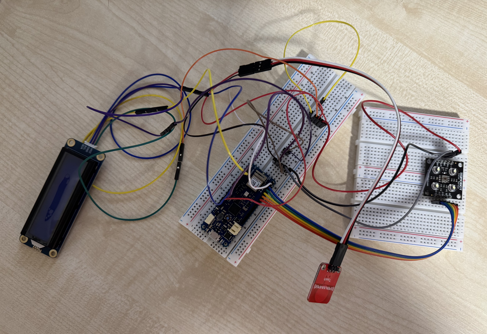
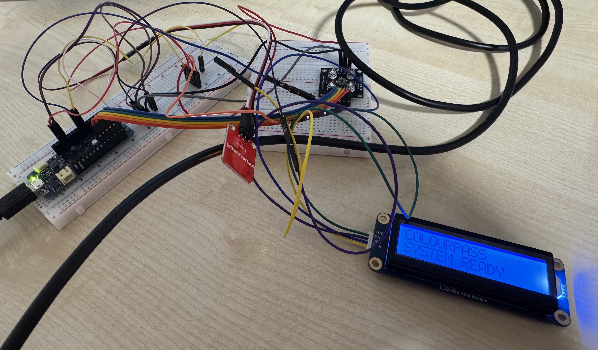
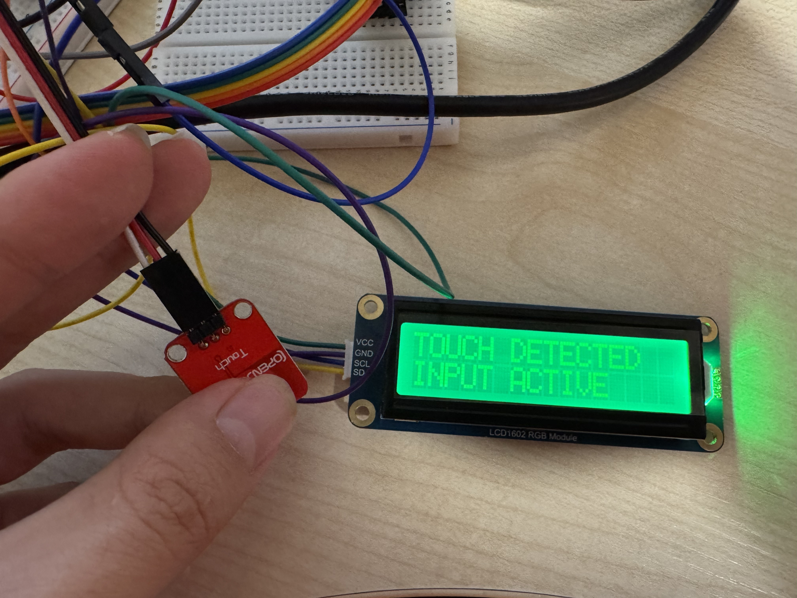
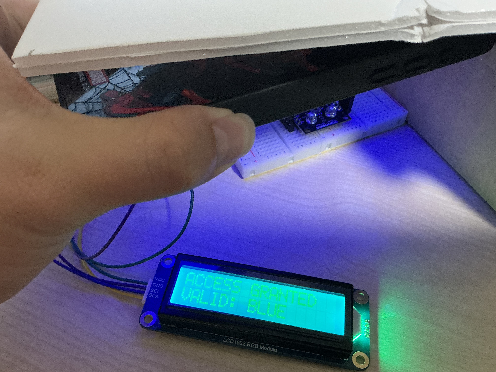
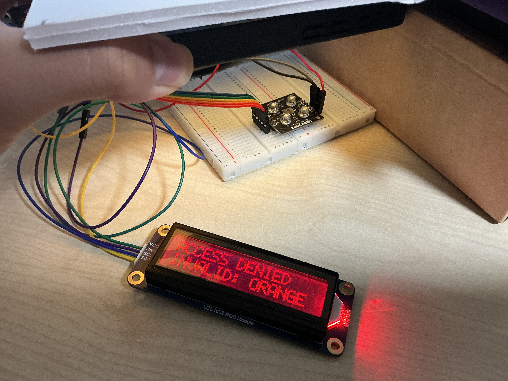

# Part 02 — Hardware Integration and Colour Calibration

**Status:** Hardware integration and preliminary colour recognition completed.

## 1. Objective

Building on [Part 01 — Colour Sensor Testing](/design-log/part-01-colour-sensing/README.md), this stage focuses on integrating the colour sensor, touch sensor and LCD1602 RGB screen with the Arduino MKR WiFi 1010.

The main objectives are:

- Integrate and test multiple hardware components.
- Verify I2C communication and touch input.
- Provide visual feedback through the LCD screen.
- Develop a preliminary colour calibration and recognition system.
- Simulate ticket validation and lighting mode selection.

The LCD screen is used to preview system responses before the final connection to the Vespera lighting installation.

## 2. Hardware Integration

The integrated prototype includes:

- Arduino MKR WiFi 1010
- DFRobot Colour Sensor
- Touch Sensor
- LCD1602 RGB Display
- Breadboard and Jumper Wires

### Wiring

| Component | Arduino Connection |
| --- | --- |
| Colour Sensor S0 | D0 |
| Colour Sensor S1 | D1 |
| Colour Sensor S2 | D2 |
| Colour Sensor S3 | D3 |
| Colour Sensor OUT | D4 |
| Colour Sensor VDD | 3.3V |
| Colour Sensor GND / OE | GND |
| Touch Sensor Signal | D5 |
| Touch Sensor Power | 3.3V |
| Touch Sensor GND | GND |
| LCD SDA | D11 |
| LCD SCL | D12 |
| LCD VCC | 3.3V |
| LCD GND | GND |

### Integrated Circuit Prototype

## 3. Hardware Testing

### Step 1 — I2C and Touch Sensor Testing

The first test verifies communication between the Arduino and connected I2C devices.

The program scans I2C addresses and displays detected devices in the Serial Monitor.

It also reads the touch sensor state to confirm whether touch input can be detected.

**Code:**

[ColourPass_Hardware_I2C_Test.ino](/design-log/part-02-hardware-integration-and-colour-calibration/ColourPass_Hardware_I2C_Test.ino)

### Step 2 — LCD Screen Testing

The LCD1602 RGB screen was connected and tested to provide visual feedback.

The screen displays:

- COLOURPASS
- SYSTEM READY

The RGB backlight is initially blue.

Touch interaction was then integrated with the display.

When a touch is detected:

- The LCD displays "TOUCH DETECTED".
- The second line displays "INPUT ACTIVE".
- The backlight changes to green.

When the touch is released, the display returns to the ready screen.

**Code:**

[ColourPass_LCD_Touch_Test.ino](/design-log/part-02-hardware-integration-and-colour-calibration/ColourPass_LCD_Touch_Test.ino)

**Screen Testing**

**LCD and Touch Sensor Testing**

## 4. Colour Calibration and Recognition

After hardware integration, a more advanced colour recognition program was developed.

The program combines:

- Colour sensing
- Touch interaction
- LCD feedback
- Background calibration
- Colour classification
- Preliminary ticket validation

**Code:**

[ColourPass_ColourCalibration_and_Recognition.ino](/design-log/part-02-hardware-integration-and-colour-calibration/ColourPass_ColourCalibration_and_Recognition.ino)

### Step 3 — Background Calibration

One problem identified during testing was the influence of ambient lighting on colour recognition.

Without background calibration, the sensor could occasionally identify the surrounding environment as a coloured card.

To reduce this problem, the program records the empty background when the system starts.

Users must keep the sensor clear during initial background capture.

The background reference helps distinguish coloured cards from the surrounding environment.

### Step 4 — Colour Calibration

The system supports the calibration of nine colours:

1. Red
2. Orange
3. Pink
4. Yellow
5. Green
6. Blue
7. Purple
8. White
9. Black

During calibration:

- The LCD displays the required colour.
- The user places the corresponding colour card near the sensor.
- A touch input captures the sensor reading.
- The measurement is stored as a colour reference.
- The system proceeds to the next colour.

After all nine colours have been calibrated, users are asked to remove the cards and confirm the empty background again.

This calibration process is intended to make recognition more adaptable to different lighting conditions.

### Step 5 — Colour Recognition

The program compares new sensor readings with the stored colour references.

Several techniques are used to improve recognition stability:

- Median filtering of sensor readings.
- Normalised colour features.
- Comparison with the empty background.
- Distance-based colour classification.
- Rejection of ambiguous measurements.
- Multiple consistent readings before detection.

These methods aim to reduce accidental recognition and improve classification reliability.

However, further testing is required to evaluate their accuracy.

## 5. Preliminary Ticket Validation

The recognised colour determines the intended ticket response.

| Card Colour | Validation | Lighting Preview |
| --- | --- | --- |
| Red | Denied | Red feedback |
| Orange | Denied | Red feedback |
| Pink | Denied | Red feedback |
| Yellow | Granted | Static Mode |
| Green | Granted | Static Mode |
| Blue | Granted | Ambient Mode |
| Purple | Granted | Ambient Mode |
| White | No Mode | No lighting mode |
| Black | No Mode | No lighting mode |

For valid tickets, the LCD displays an access-granted message before entering the selected lighting preview.

The touch sensor can be used to switch between different colour or ambient-effect previews.

A three-second long press initiates a reset.

At this stage, the lighting effects are represented through the LCD RGB backlight rather than the final Vespera installation.

### Colour Recognition Testing

**Blue Colour Calibration and Recognition**

**Orange Colour Calibration and Recognition**

## 6. Observations and Limitations
The LCD provides immediate feedback and makes interaction states easier to understand without depending entirely on the Serial Monitor.

Recording the empty environment matters because sensor positioning, ambient light and the eventual physical enclosure can influence measurements.

Similar colours and lighting changes can still lead to unreliable recognition. Further calibration is needed, particularly for yellow and neighbouring colours.

The uploaded test sketch currently allows consecutive ticket detection when a different colour is presented. A single-ticket lockout until reset has not yet been implemented in this file.

This stage documents local hardware testing and screen previews. It does not demonstrate completed Wi-Fi/MQTT lighting control or the final physical enclosure.
