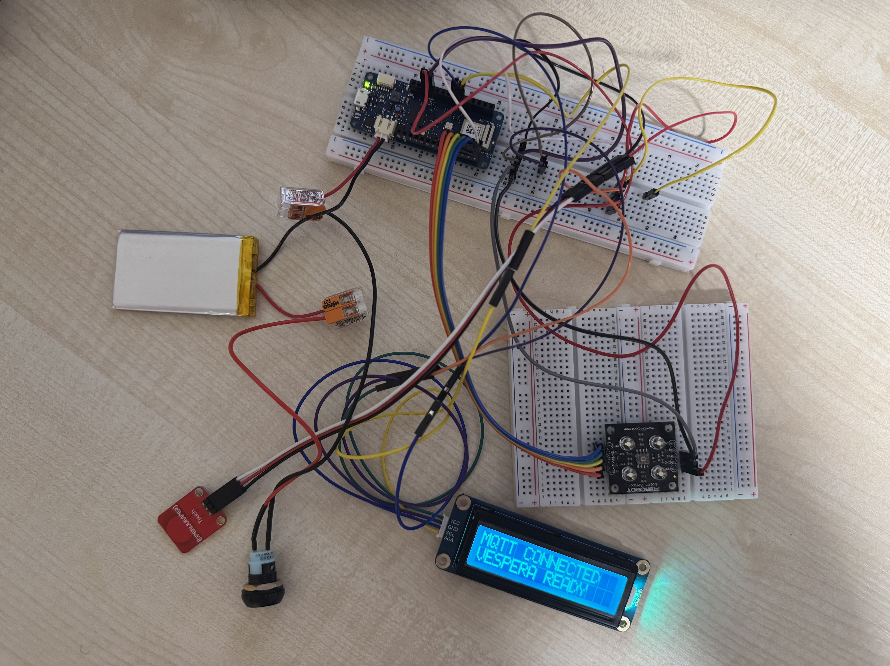
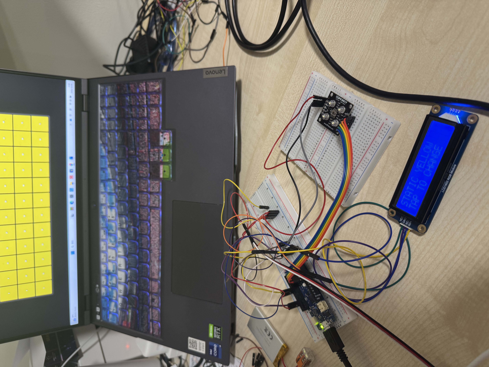
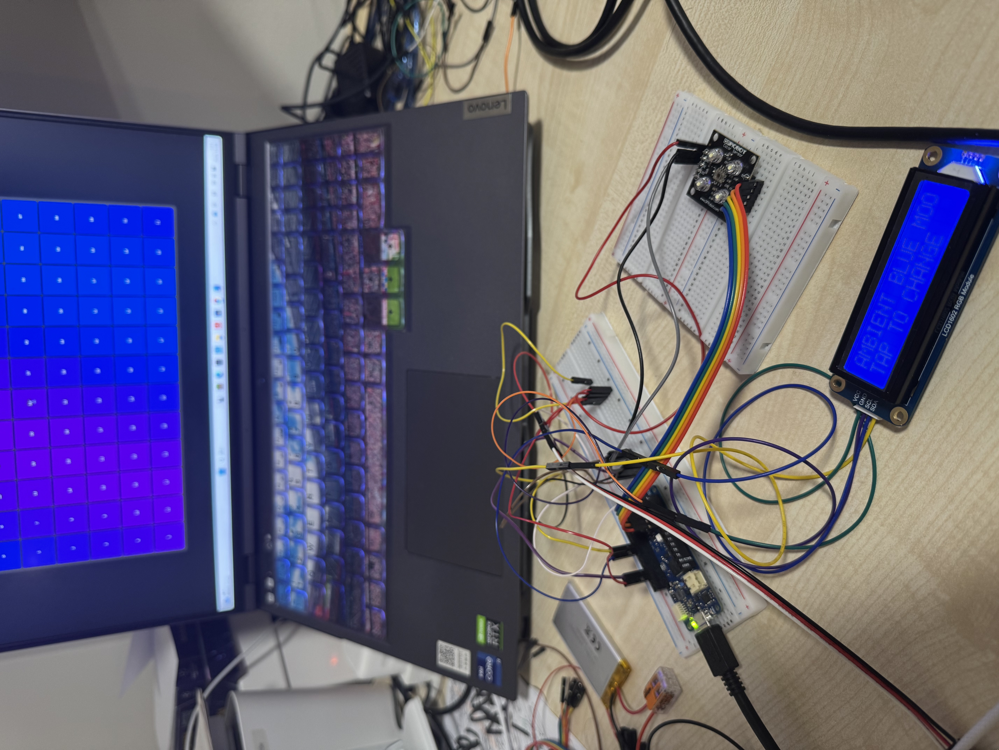
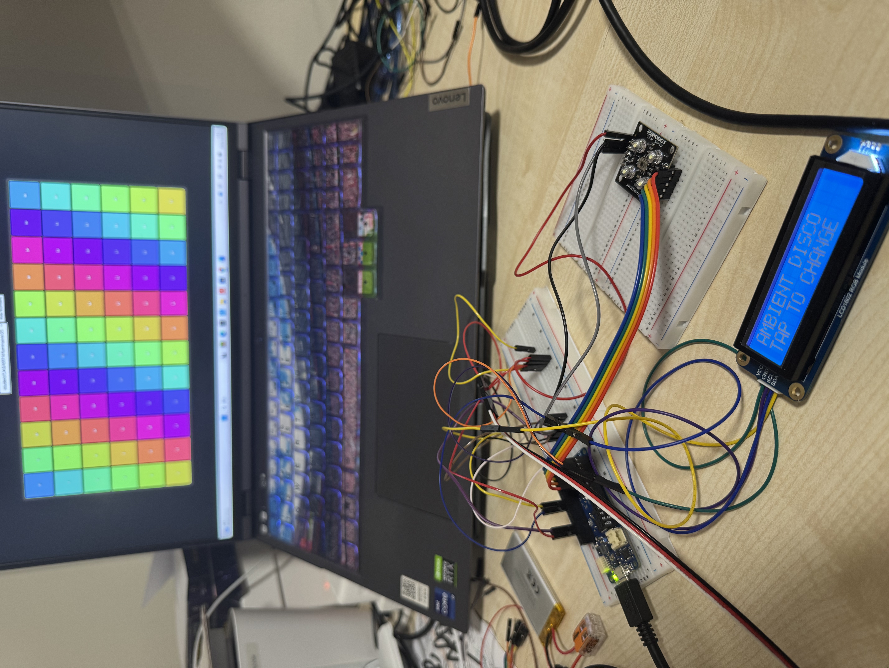
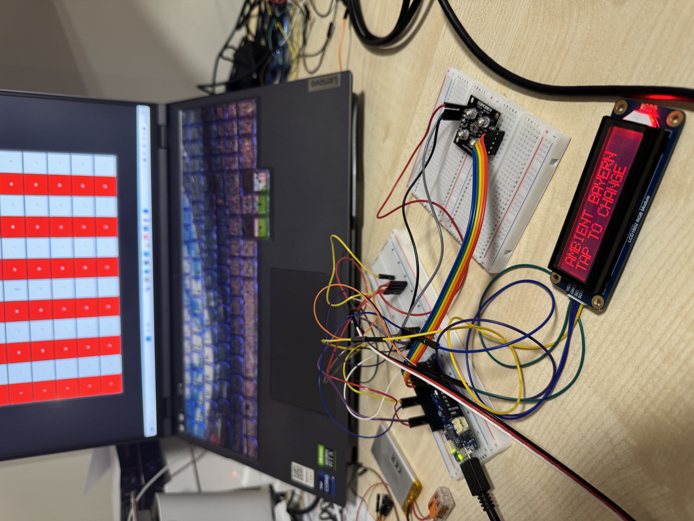

# Part 03 — MQTT Integration and Lighting Control

**Status:** Modular software integration completed; MQTT communication and lighting effects tested using the Lumi web simulator.

## 1. Objective

Building on [Part 02 — Hardware Integration and Colour Calibration](../part-02-hardware-integration-and-colour-calibration/README.md), this stage focuses on transforming ColourPass from a local colour-recognition prototype into an interactive lighting-control system.

The main objectives are:

- Integrate Wi-Fi and MQTT communication using the Arduino MKR WiFi 1010.
- Connect colour-based ticket validation to the Vespera lighting system.
- Implement static and dynamic lighting effects.
- Support continuous ticket scanning and touch-based lighting control.
- Introduce white standby lighting and visual feedback for ticket validation.
- Refactor the original Arduino sketch into a modular software architecture.
- Test remote lighting output using the Lumi web simulator.

## 2. Hardware Integration

The integrated prototype includes:

- Arduino MKR WiFi 1010
- Colour sensor
- Capacitive touch sensor
- LCD1602 RGB display
- Adafruit NeoPixel LED strip
- Power switch
- Breadboard and jumper wires

The existing hardware connections from Part 02 were retained, with the NeoPixel strip connected to digital pin D6.

### Prototype Circuitry

The following photograph documents the integrated circuit arrangement, including the switch and hardware configuration being explored for a battery-powered prototype.

This stage focuses on functional hardware and software integration. Final physical enclosure construction and battery-powered reliability testing remain separate development tasks.

## 3. Modular Software Architecture

The previous Colour Calibration and Recognition sketch contained most functions in a single Arduino file.

As the project expanded to include networking, lighting animations and more complex interaction states, the code was reorganised into separate modules.

This improves readability, maintainability and extensibility, while allowing individual features to be developed and tested more independently.

### Software Components

| File | Function |
| --- | --- |
| `ColourPass_Vespera_V1.ino` | Main program, system states and interaction coordination |
| `Config.h` | Hardware pin assignments, timing parameters, recognition thresholds and MQTT configuration |
| `ColourModels.h` | Ticket colours, system states and lighting-output definitions |
| `ColourSensor.h / .cpp` | Sensor readings, calibration, filtering and colour classification |
| `TouchInput.h / .cpp` | Touch detection, debouncing and gesture recognition |
| `LCDView.h / .cpp` | LCD text display and RGB backlight feedback |
| `LightingEngine.h / .cpp` | Static colours, dynamic lighting effects and RGB frame generation |
| `VesperaClient.h / .cpp` | Wi-Fi connectivity, MQTT communication and reconnection handling |
| `arduino_secrets.h.example.h` | Example network credentials without real passwords |

The main Arduino program coordinates these modules through a state-based control system.

This architecture separates sensing, processing, interaction, communication and lighting output.

**Main program:** [ColourPass_Vespera_V1.ino](./ColourPass_Vespera_V1.ino)

## 4. MQTT Integration

The Arduino MKR WiFi 1010 uses the `WiFiNINA` library for wireless connectivity and `PubSubClient` for MQTT communication.

The workflow is:

1. The colour sensor measures a presented card.
2. The Arduino classifies the colour using calibrated reference values.
3. The validation logic determines the appropriate lighting response.
4. The Lighting Engine generates RGB values.
5. The Vespera Client publishes the RGB data to an MQTT Broker.
6. The Lumi web simulator visualises the resulting lighting output.

The lighting output is represented as a **12 × 6 LED matrix**, with three RGB values for each LED.

Therefore, each complete frame contains:

**12 × 6 × 3 = 216 bytes**

The software also supports automatic Wi-Fi and MQTT reconnection attempts, helping maintain communication after temporary network interruptions.

### Network Configuration and Security

Network credentials are stored separately from the main program.

For security reasons, the publicly uploaded version does not contain active Wi-Fi or MQTT passwords. The MQTT connection details in `Config.h` are also replaced with placeholders.

To run the project, an authorised user must configure the MQTT settings and create a local `arduino_secrets.h` file based on the supplied example.

The current implementation uses standard MQTT over TCP rather than MQTT over TLS. Encrypted communication is a potential future improvement, subject to server support.

## 5. Ticket Validation and Lighting Interaction

ColourPass uses coloured cards as simulated tickets. The recognised colour determines whether access is granted and which lighting mode becomes available.

### Ticket Validation Rules

| Ticket Colour | Validation | Lighting Response |
| --- | --- | --- |
| Red | Denied | Flashing red, then white standby |
| Orange | Denied | Flashing red, then white standby |
| Pink | Denied | Flashing red, then white standby |
| Yellow | Granted | Green-white confirmation, then Static Mode |
| Green | Granted | Green-white confirmation, then Static Mode |
| Blue | Granted | Green-white confirmation, then Ambient Mode |
| Purple | Granted | Green-white confirmation, then Ambient Mode |
| White | Not authorised | No new lighting response |
| Black | Not authorised | No new lighting response |
| Unknown | Not authorised | No new lighting response |

The system displays white lighting during startup and standby.

Successful validation triggers a **two-second animated green-white gradient**, providing visual confirmation before entering the selected lighting mode.

Rejected tickets trigger flashing red lighting for approximately 1.9 seconds before returning to white standby.

The system supports continuous ticket validation without requiring a restart between different cards. Repeated detection of the same card is controlled to reduce unintended retriggering.

### Static Lighting Mode

Yellow and green tickets activate Static Mode.

The system supports six colours:

**Yellow → Green → Cyan → Blue → Purple → Pink → Yellow**

A yellow ticket starts with yellow lighting, while a green ticket starts with green lighting.

Each short touch advances to the next colour in the cycle.

### Ambient Lighting Mode

Blue and purple tickets activate Ambient Mode.

Six lighting themes are implemented:

| Theme | Lighting Behaviour |
| --- | --- |
| Blue Mood | Animated blue-purple gradient |
| Rainbow | Static rainbow pattern |
| Forest | Animated green and turquoise wave |
| Sunset | Animated orange, red and purple gradient |
| Disco | Dynamic multicolour lighting |
| Bayern | Static alternating red and white columns |

A blue ticket initially activates **Blue Mood**, while a purple ticket initially activates **Rainbow**.

The touch interface follows a seven-position sequence containing six unique themes, with Blue Mood appearing twice:

**Blue Mood → Rainbow → Blue Mood → Forest → Sunset → Disco → Bayern → repeat**

The different initial positions allow the same lighting system to provide distinct starting experiences for blue and purple tickets.

### Touch Controls

| Gesture | Function |
| --- | --- |
| Short tap during calibration | Capture the current colour reference |
| Short tap during lighting mode | Switch to the next effect |
| Hold for 3–5 seconds, then release | Recheck the background |
| Hold for at least 5 seconds, then release | Restart and recalibrate the system |

## 6. MQTT and Lighting Simulation Testing

The integrated system was tested using the [Lumi web simulator](https://www.iot.io/projects/lumi/), allowing RGB lighting frames to be visualised remotely.

During development, the Arduino successfully connected to the MQTT Broker using a mobile hotspot, and lighting responses were observed through the browser-based simulation.

The following photographs document selected lighting effects.

### Test 1 — Yellow Static Lighting

The yellow lighting output demonstrates the Static Mode response.

### Test 2 — Blue Mood

The Blue Mood theme uses changing blue and purple RGB values to create a flowing gradient.

### Test 3 — Disco Lighting

The Disco theme generates dynamic multicolour lighting across the simulated LED matrix.

### Test 4 — Bayern Lighting

Inspired by FC Bayern Munich's red and white colours, this theme displays alternating red and white columns.

These tests demonstrate the integration of lighting generation, MQTT transmission and browser-based visualisation. They do not independently verify the physical Vespera installation.

## 7. Observations and Limitations

### Successful Integration

The modular architecture makes it easier to modify colour recognition, interaction logic and lighting effects without rewriting the entire program.

The MQTT connection successfully transmitted RGB data to the Lumi web simulator. The local NeoPixel strip also provides a simplified lighting preview.

Separating the Lighting Engine from the MQTT Client allows lighting patterns to be generated independently of the network communication code.

### Colour Recognition Reliability

Colour recognition remains sensitive to lighting conditions, sensor positioning and the distance between the card and sensor.

Recognition thresholds and brightness-related weighting were adjusted to improve sensitivity, but these changes require further evaluation to determine whether they improve accuracy across all colours.

Future testing should collect repeated measurements under controlled conditions rather than relying entirely on threshold adjustments.

### Network Connectivity

MQTT connection attempts over the student accommodation network encountered timeouts, while connection through a mobile hotspot succeeded.

This highlights the influence of network configuration and access restrictions on connected physical devices.

The software includes reconnection mechanisms, but network reliability and latency have not yet been systematically evaluated.

### Prototype Limitations

- Colour-based ticket validation is a demonstration of interactive access control, not secure identity authentication.
- Calibration profiles are stored in memory and must currently be recreated after restarting.
- The colour sensor still requires further accuracy testing.
- The local NeoPixel strip provides a simplified preview of the larger Vespera LED matrix.
- MQTT transmission is not currently protected by TLS.
- Remote Lumi simulation does not establish that the physical Vespera installation has been tested successfully.
- The final physical enclosure and extended battery-powered operation remain to be evaluated.

