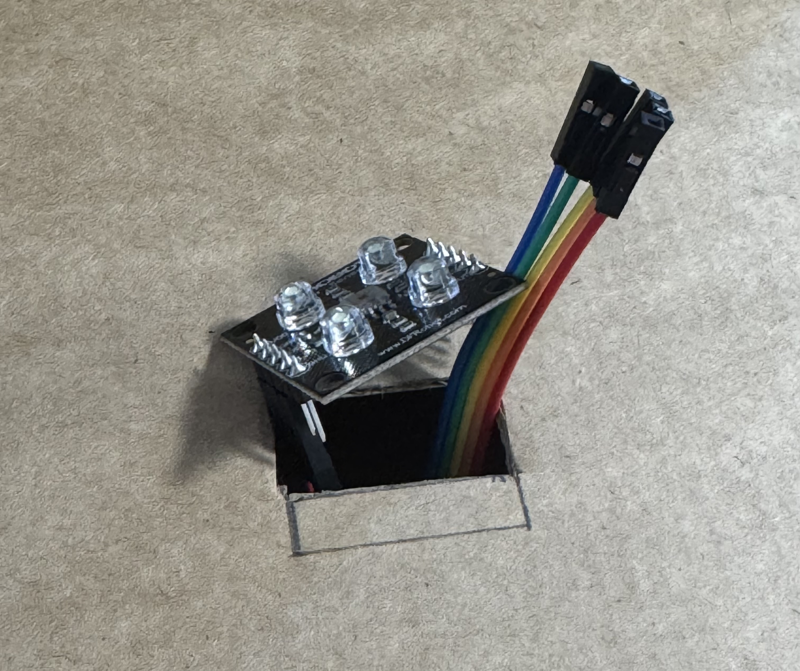
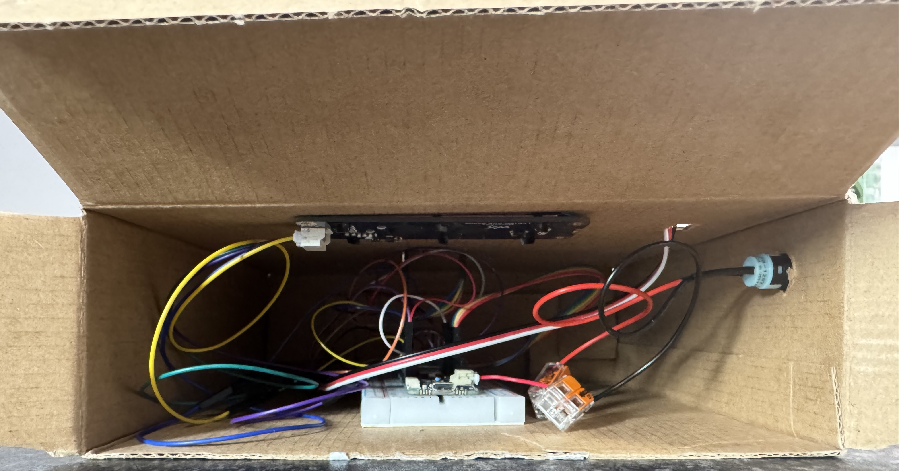
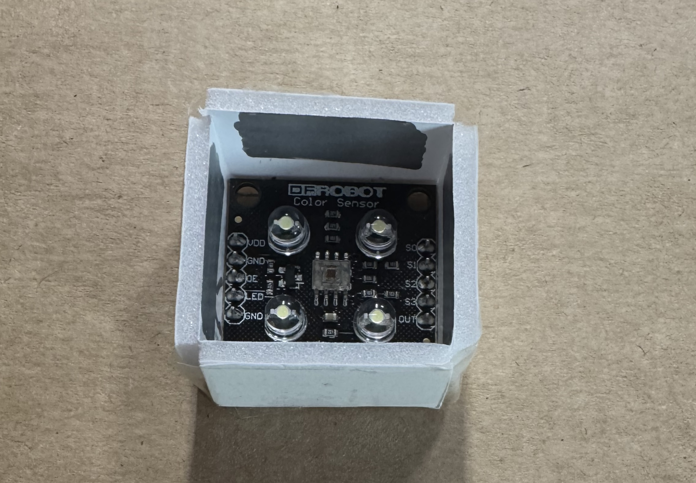
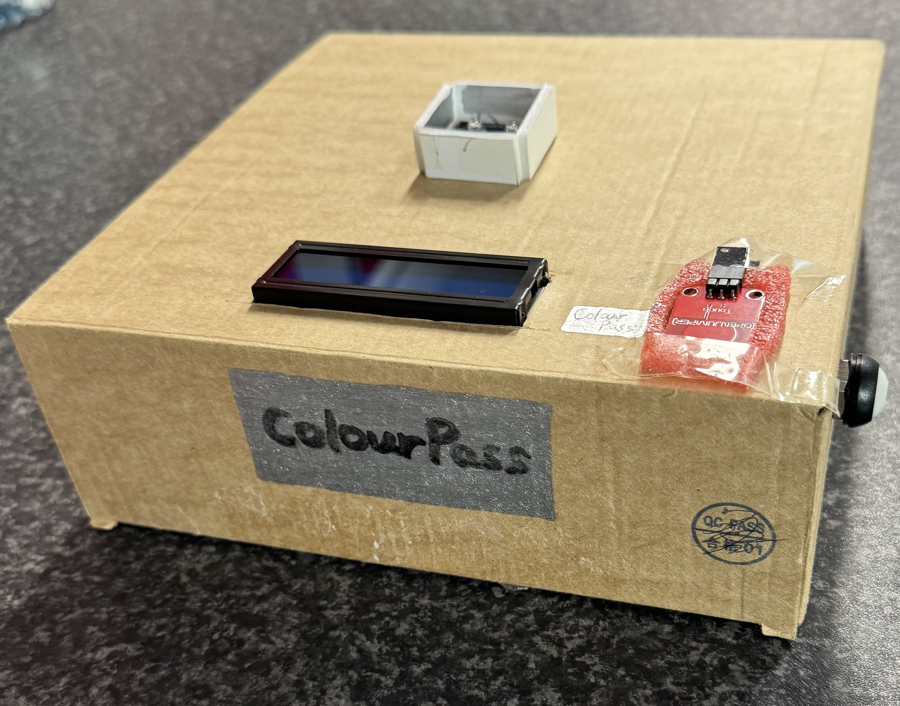

# Part 04 — Physical Prototype Construction

**Status:** Cardboard enclosure assembled, with an additional light-shielding modification following initial colour-recognition testing.

## 1. Objective

Building on [Part 03 — MQTT Integration and Lighting Control](../part-03-mqtt-integration-and-lighting-control/README.md), this stage focuses on turning the connected ColourPass circuit into a physical, user-facing prototype.

The main objectives are:

- Construct a medium-fidelity enclosure using cardboard and simple hand tools.
- Provide dedicated openings for the colour sensor, LCD screen, touch sensor and power switch.
- Organise the Arduino board, wiring and other electronic components inside the enclosure.
- Evaluate how the enclosure influences colour recognition and improve the design through testing.
- Make the prototype easier to handle and demonstrate as a ticket-scanning interface.

The enclosure was constructed without 3D printing, in keeping with the physical prototyping approach used in the module.

## 2. Materials and Design Considerations

The prototype brings together the Arduino MKR WiFi 1010, colour sensor, capacitive touch sensor, LCD1602 RGB display, NeoPixel lighting and physical power switch developed in the previous stages.

Cardboard was chosen because it is inexpensive, easy to mark and cut, and suitable for quick adjustments during prototyping.

The layout needed to balance three considerations:

- **Interaction:** The screen, scanning area, touch input and switch should be accessible from outside the enclosure.
- **Component placement:** Openings must accommodate the size and position of each component while leaving room for wiring.
- **Sensor performance:** The colour sensor needs a reasonably consistent scanning area with less interference from surrounding light.

## 3. Construction Process

### Step 1 — Measuring and Marking the Cutting Areas

Before cutting the cardboard box, I used a pencil to mark the planned cutting areas for the components.

This preparation helped identify where openings were needed and reduced the risk of cutting the enclosure in the wrong positions.

### Step 2 — Mounting the Colour Sensor

After preparing the openings, the colour sensor was positioned in the enclosure so that coloured cards could be presented from outside the box.

The sensor wiring was routed towards the internal electronics, allowing the scanning surface to remain accessible while keeping the connections inside the prototype.

### Step 3 — Internal Wiring and Component Assembly

The Arduino and connected components were arranged inside the cardboard enclosure, with wiring brought through the relevant openings.

This step brought the individual hardware modules together into one physical assembly. Once the components were installed, I began testing the colour-scanning function in the assembled enclosure.

### Step 4 — Testing and Adding a Light-Shielding Frame

During initial testing **after assembling the components**, I noticed that colour recognition was less stable than expected. The readings appeared to be affected by surrounding light and the position of the card relative to the sensor.

Based on this observation, I decided to add a small raised frame around the colour sensor. The frame helps block some light entering from the sides and provides a more consistent area for presenting a ticket.

Preliminary testing after this modification suggested improved recognition stability. However, this was a qualitative observation rather than a measured increase in classification accuracy.

### Step 5 — Assembled Physical Prototype

The assembled ColourPass prototype brings the screen, colour-scanning area, touch interaction and physical switch into one enclosure.

The cardboard construction provides a tangible interface for demonstrating the ticket-validation concept while allowing further modifications if testing reveals additional problems.

## 4. Design Iteration — Improving Colour Recognition

A key lesson from this stage was that software calibration alone does not guarantee reliable sensor readings once the electronics are installed in a physical enclosure.

I first completed the internal component assembly and then tested colour recognition with the sensor mounted in the cardboard box. The inconsistent results motivated a **subsequent physical design change**, rather than the light-shielding frame being part of the initial enclosure plan.

The development sequence was:

**Assembly → Initial testing → Problem identified → Light-shielding modification → Preliminary retesting**

- **Initial test:** Colour recognition was inconsistent under some lighting and positioning conditions.
- **Observation:** Surrounding light and card placement appeared to influence sensor readings.
- **Modification:** A raised border was added around the sensor to reduce light entering from the sides and guide card placement.
- **Preliminary result:** Recognition appeared more consistent during subsequent tests.
- **Remaining question:** How much does the frame improve recognition accuracy under repeated, controlled conditions?

This iteration illustrates how the performance of an IoT device depends on both its software and the physical environment in which its sensors operate.

## 5. Observations and Limitations

The cardboard enclosure made ColourPass more practical to demonstrate than the earlier exposed breadboard arrangement. It also revealed design issues that were less obvious when testing components separately.

However, several limitations remain:

- **Colour recognition:** The perceived improvement from the light-shielding frame has not yet been quantified. Similar colours and changing illumination may still cause errors.
- **Positioning:** The distance and angle between a card and the sensor can affect the reading.
- **Enclosure durability:** Cardboard is suitable for a medium-fidelity prototype but is not intended as a permanent protective housing.
- **Power and networking:** Extended battery-powered operation and network reliability inside the assembled enclosure still require systematic testing.
- **Integration:** The complete workflow should be tested repeatedly with the enclosure fully assembled.
