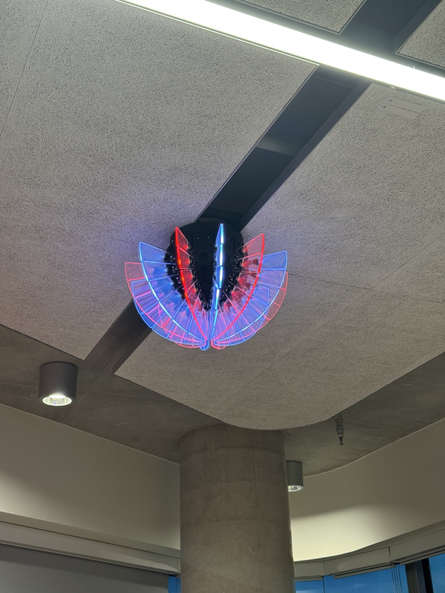
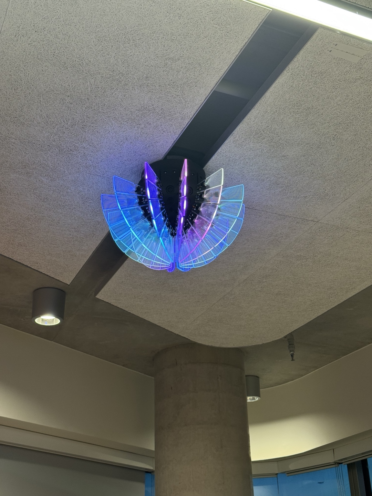
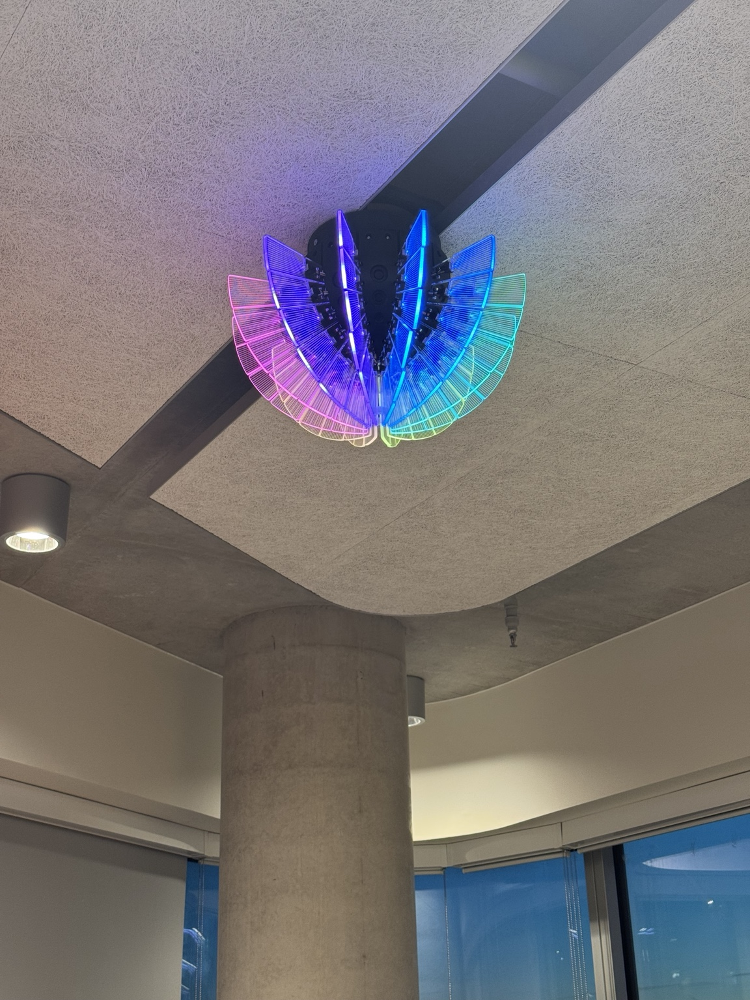
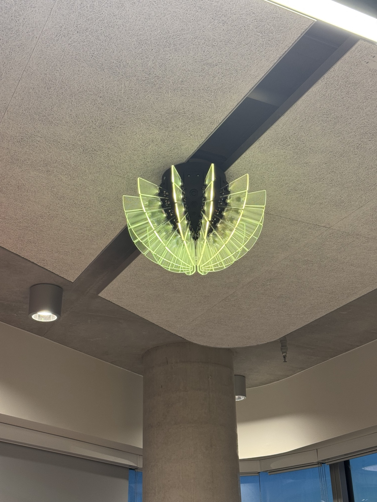

# Part 05 — Colour Recognition and Code Refinement

## 1. Overview

This stage focused on refining colour recognition and preparing **ColourPass–Vespera** for a short live demonstration. Testing was carried out in the **Connected Environments Lab at One Pool Street, UCL East**, using the physical ColourPass prototype and the Vespera lighting installation.

The main improvement was to separate colour calibration from everyday operation: I first measured and recorded the reference values for nine colour cards, then updated the Arduino code to load those values automatically. This removed the need to calibrate each card again during the final demonstration.

This stage builds on [Part 04 — Physical Prototype Construction](../part-04-physical-prototype-construction/README.md).

## 2. On-site Colour Calibration

I tested the colour sensor inside the assembled prototype and recorded the raw **R, G, B and C pulse readings** from the Arduino Serial Monitor. The cards were placed in the designated scanning area to keep the measurement position as consistent as possible.

After reviewing the first results, I remeasured **orange and pink** and replaced their earlier reference values. The updated readings were used in the refined code.

### Final Colour Calibration Reference Table

| Colour | R | G | B | C | Intended response |
| --- | ---: | ---: | ---: | ---: | --- |
| Red | 153 | 1997 | 143 | 1328 | Access denied |
| Orange | 196 | 813 | 152 | 1147 | Access denied |
| Pink | 244 | 1177 | 159 | 681 | Access denied |
| Yellow | 108 | 260 | 70 | 505 | Access granted — static mode |
| Green | 356 | 217 | 105 | 595 | Access granted — static mode |
| Blue | 4852 | 1405 | 286 | 391 | Access granted — ambient mode |
| Purple | 483 | 1594 | 252 | 671 | Access granted — ambient mode |
| White | 103 | 175 | 50 | 185 | No new lighting action |
| Black | 56 | 135 | 32 | 166 | No new lighting action |

An example empty-background reading was **R: 52, G: 126, B: 30, C: 154**. These values are measurements from the colour sensor, **not standard RGB colour codes**. The full reference table is available in [`Colour Calibration Reference Table.xlsx`](Colour%20Calibration%20Reference%20Table.xlsx).

## 3. Code Refinement for the Demonstration

Earlier versions required the nine cards to be calibrated manually each time the Arduino restarted. This was useful during development but took too long for a short demonstration.

The refined program now:

1. Waits until both **Wi-Fi and MQTT** connections are established before enabling normal interaction.
2. Loads the nine recorded colour profiles from `ColourSensor.cpp` using `loadPresetProfiles()`.
3. Prompts for a clear scanning area and captures a fresh **empty-background reading** at startup.
4. Enters `COLOURPASS / SCAN YOUR TICKET` automatically, without the nine-card calibration sequence.
5. Retains continuous ticket scanning, LCD feedback, touch controls, and static/ambient lighting modes.

Keeping the automatic background measurement is important because environmental lighting can vary, even when the reference values are stored in the code. A three-second hold still requests a background recheck; a five-second hold restarts the controller and reloads the saved profiles.

The current main sketch in this folder is named [`ColourPass_Vespera_v2.0.ino`](ColourPass_Vespera_v2.0.ino), although its source header identifies the updated **v3.0** demonstration logic. The preset data and loading function are in [`ColourSensor.cpp`](ColourSensor.cpp) and [`ColourSensor.h`](ColourSensor.h).

## 4. Vespera Lighting Tests

After collecting the colour measurements and updating the code, I tested the controller with the **real Vespera installation in the Connected Environments Lab at One Pool Street**. The photographs below document lighting effects successfully displayed during on-site testing.

### Bayern Lighting

### Disco Lighting

### Rainbow Lighting

### Yellow Lighting

These photographs record the physical installation rather than the local NeoPixel simulation used during earlier development.

## 5. Observations and Limitations

In the latest hands-on tests, **colour recognition worked well across the set of cards**, and the revised orange and pink reference values gave satisfactory results in the tested setup. The photographs also document successful Vespera lighting outputs.

The results remain dependent on the placement of the card, sensor position, ambient lighting and network connectivity. In particular, the recorded white and black readings are close to the empty-background reference. As neither colour is intended to authorise a lighting change, this was not critical to the demonstration, but reliable separation of these inputs from an empty scanning area remains a limitation.

This stage provides qualitative test observations; it does not claim a measured recognition-accuracy percentage or guaranteed performance in different environments.

## 6. Files and Reproduction Notes

| File | Purpose |
| --- | --- |
| [`Colour Calibration Reference Table.xlsx`](Colour%20Calibration%20Reference%20Table.xlsx) | Recorded colour-reference measurements |
| [`ColourPass_Vespera_v2.0.ino`](ColourPass_Vespera_v2.0.ino) | Main sketch containing the updated demonstration workflow|
| [`ColourSensor.cpp`](ColourSensor.cpp) | Sensor readings, classification and preset colour profiles |
| [`ColourSensor.h`](ColourSensor.h) | Colour-sensor declarations, including preset loading |
| `Vespera_*.jpg` | Photographic evidence of real lighting outputs |

These are the **files specifically documented for this stage**, rather than a complete standalone Arduino sketch directory. To reproduce the program, place the main `.ino`, `ColourSensor.cpp` and `ColourSensor.h` together with the other required source modules from [Part 03 — MQTT Integration and Lighting Control](../part-03-mqtt-integration-and-lighting-control/README.md) in one Arduino sketch folder. The project also requires local Wi-Fi/MQTT credentials in `arduino_secrets.h`.
